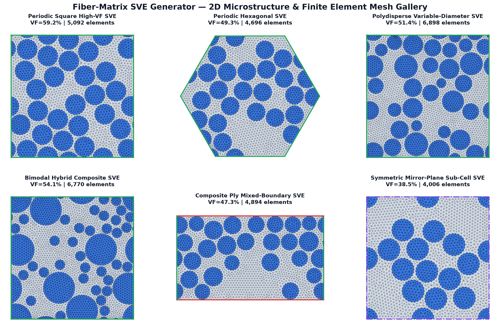
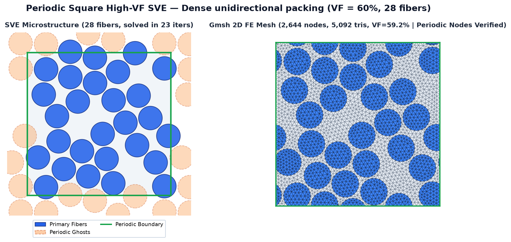
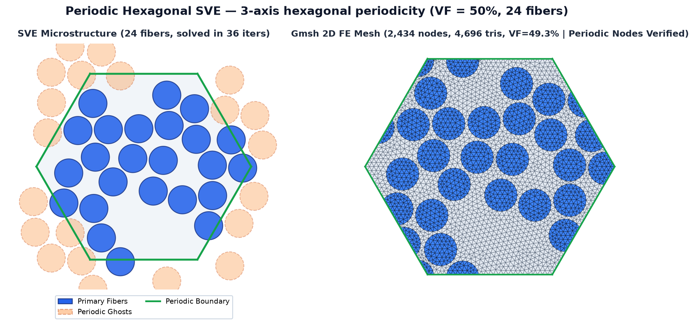
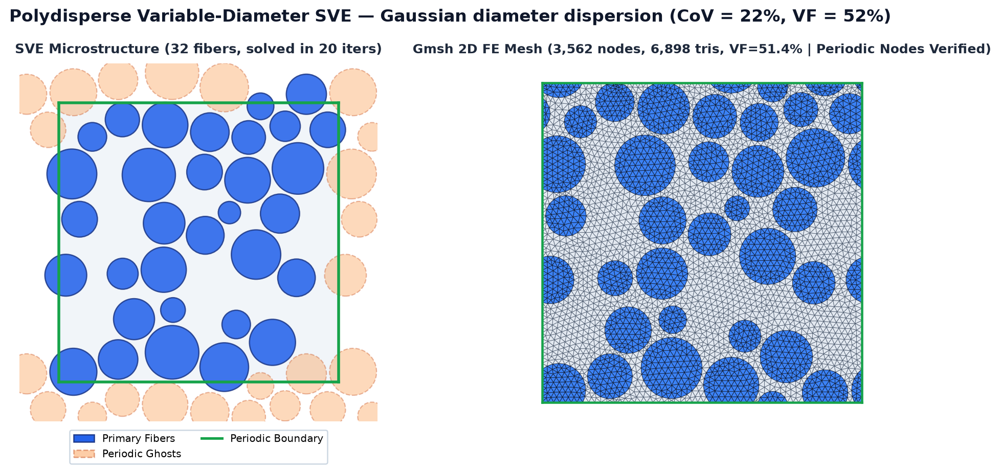
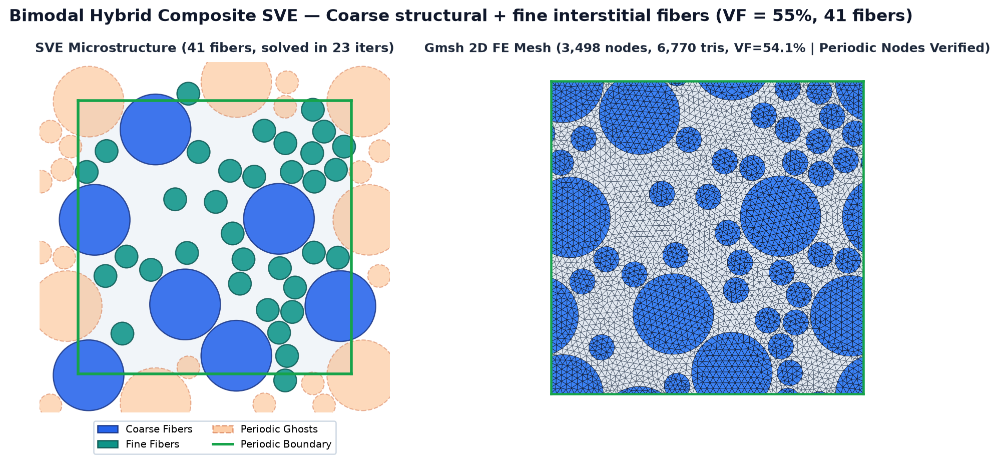
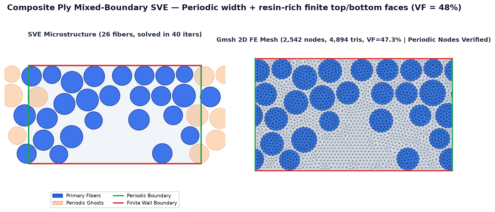
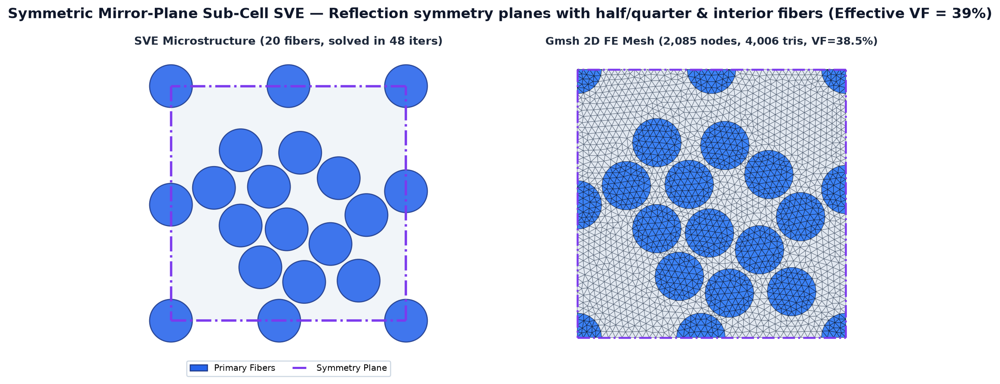
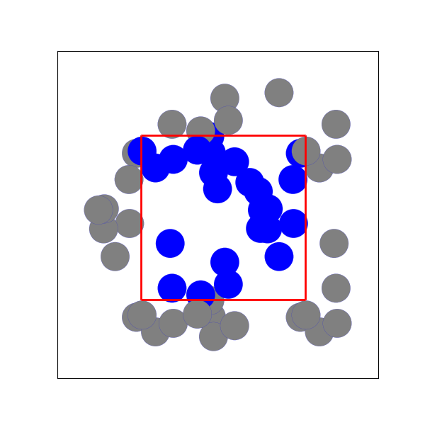

# Fiber Matrix SVE Generator


A Python library for generating Representative Volume Elements (RVEs) of fiber-reinforced composites. It handles random fiber placement, periodic boundary conditions, and generates high-quality unstructured meshes using [GMSH](https://gmsh.info/).

## Features

- **Geometric Generation**:
  - Random or user-specified fiber placement with deterministic overlap resolution (`np.random.seed`).
  - Square, rectangular, regular hexagonal, and arbitrary simple polygon RVE/SVE domains.
  - Periodic (ghost fibers + corner periodic images), finite wall, reflection-symmetric, and per-edge mixed boundary conditions.
  - Monodisperse, Gaussian polydisperse, and custom/bimodal hybrid fiber radius distributions.
- **Robust Meshing**:
  - Unstructured meshing via GMSH Python API with OpenCASCADE boolean fragmentation.
  - 2D surface meshes and extruded 3D volume meshes (tetrahedral or recombined prism/wedge elements) with periodic node verification (`KDTree`).
  - Automatic physical group tagging for `Matrix`, `Fibers`, optional material-specific or composite 3D boundary surfaces, and mechanical 3D anchor nodes.
- **Visualization**:
  - Animated GIF export of iterative fiber-packing relaxation.
  - Matplotlib plotting of RVE geometry, periodic ghost fibers, and boundary types.

## Microstructure & Mesh Gallery

All gallery figures below are generated reproducibly by [`examples/generate_gallery.py`](examples/generate_gallery.py) using the standalone scripts in [`examples/`](examples/).



### 1. Periodic Square High-VF SVE (`VF = 60%`)
Dense unidirectional fiber packing with 2-axis periodic boundary conditions, corner ghost fibers, and verified 1-to-1 periodic boundary mesh nodes.
- **Example script:** [`examples/periodic_square_rve.py`](examples/periodic_square_rve.py)



### 2. Periodic Hexagonal SVE (`VF = 50%`)
Flat-topped regular hexagonal SVE enforcing 3-axis periodic pairing across all six edges.
- **Example script:** [`examples/periodic_hex_rve.py`](examples/periodic_hex_rve.py)



### 3. Polydisperse Variable-Diameter SVE (`CoV = 22%`, `VF = 52%`)
Gaussian-distributed fiber diameters with radius-aware `KDTree` neighbor queries and periodic boundary matching.
- **Example script:** [`examples/polydisperse_square_rve.py`](examples/polydisperse_square_rve.py)



### 4. Bimodal Hybrid Composite SVE (`VF = 55%`)
Hybrid reinforcement combining coarse primary structural fibers and fine interstitial fibers via explicit `radii` specification.
- **Example script:** [`examples/bimodal_hybrid_rve.py`](examples/bimodal_hybrid_rve.py)



### 5. Composite Ply Mixed-Boundary SVE (`VF = 48%`)
Thin composite ply cross-section combining `PERIODIC` lateral boundaries (along ply width) with `FINITE` resin-rich top and bottom ply surfaces.
- **Example script:** [`examples/composite_ply_mixed_rve.py`](examples/composite_ply_mixed_rve.py)



### 6. Symmetric Mirror-Plane Sub-Cell SVE
Reflection-symmetric unit/sub-cell (`BoundaryType.SYMMETRIC`) supporting quarter-fibers at corners, half-fibers centered on symmetry planes, and interior fibers.
- **Example script:** [`examples/symmetric_unit_cell_rve.py`](examples/symmetric_unit_cell_rve.py)



### Iterative Overlap-Resolution Animation
During `solve_fiber_locations`, overlapping random placements are iteratively relaxed while enforcing minimum inter-fiber spacing and periodic/wall constraints:

<p align="center">
  
</p>

## Installation

### Prerequisites

- Python 3.8+
- [GMSH SDK](https://gmsh.info/) (installed via `pip`)

### Install Dependencies

```bash
pip install -r requirements.txt
```

For building documentation:
```bash
pip install .[docs]
```

For development (editable install with testing dependencies):
```bash
pip install -e ".[dev]"
```

## Packaging

To build the library as a `.whl` (wheel) file for distribution:

1. Ensure you have `build` installed:
   ```bash
   pip install build
   ```

2. Run the build command:
   ```bash
   python -m build
   ```

The output `.whl` and `.tar.gz` files will be located in the `dist/` directory.

## Quick Start

### 1. Generate and Mesh an RVE

Here is a minimal example to generate a square SVE with periodic boundaries and create a mesh.

```python
from fiber_matrix.rve import FiberRVE

# 1. Initialize RVE
rve = FiberRVE()
rve.initialize_rectangle_rve(
    num_fibers=20,
    vf=0.45,
    avg_diam=5.0,  # microns
    rve_aspect_ratio=1.0
)

# 2. Place Fibers (Solve for non-overlapping configuration)
print("Solving fiber placement...")
iterations = rve.solve_fiber_locations(
    min_spacing_ratio=0.05,
    visualization_path="my_composite_rve.gif",  # Optional GIF of packing relaxation
)
print(f"Solved in {iterations} iterations.")

# 3. Generate Mesh (Save to .msh file)
print("Generating mesh...")
rve.create_mesh(
    mesh_name="my_composite_rve",
    mesh_size_factor=1.0,
    visualize_gui=False
)
print("Mesh generated: my_composite_rve.msh")
```

### 2. Generate a 3D Volume Mesh

The 2D RVE geometry can also be extruded into a 3D volume mesh. For a cubic
RVE, use the generated square RVE width as the extrusion thickness.

```python
from fiber_matrix.rve import FiberRVE

rve = FiberRVE()
rve.initialize_rectangle_rve(
    num_fibers=20,
    vf=0.45,
    avg_diam=5.0,
    rve_aspect_ratio=1.0
)

iterations = rve.solve_fiber_locations(
    min_spacing_ratio=0.1,
    visualization_path="my_composite_rve_3d.gif"
)
print(f"Solved in {iterations} iterations.")

rve.create_3d_mesh(
    mesh_name="my_composite_rve_3d",
    thickness=rve.rve_dims[0],
    mesh_size_factor=1.0,
    z_layers=16,
    visualize_gui=False,
    check_periodicity=True,
    periodic_z=False,
    surface_groups=True,
    composite_surface_groups=False,
    anchor_node_groups=True,
    uniform_mesh=False,
    fiber_mesh_size=0.25,
    matrix_mesh_size=0.75,
    boundary_mesh_size=0.25,
    interface_refinement_distance=0.75,
    boundary_refinement_distance=0.75,
    recombine_prisms=True,
)
print("3D mesh generated: my_composite_rve_3d.msh")
```

When `surface_groups=True`, the 3D mesh includes volume groups named `Matrix`
and `Fibers`, plus material-specific physical surface groups:

```text
Matrix_Left    Matrix_Right    Matrix_Bottom
Matrix_Top     Matrix_Front    Matrix_Back
Fibers_Left    Fibers_Right    Fibers_Bottom
Fibers_Top     Fibers_Front    Fibers_Back
```

When `composite_surface_groups=True`, the 3D mesh also includes whole-face
surface groups that combine matrix and fiber patches:

```text
composite_left    composite_right    composite_bottom
composite_top     composite_front    composite_back
```

When `anchor_node_groups=True`, the 3D mesh includes three 0D physical groups
for mechanical constraints:

```text
anchor_xyz    left-front-bottom corner
anchor_yz     right-front-bottom point along the x direction
anchor_z      left-back-bottom point in the xy plane
```

For MOOSE/libMesh, avoid overlapping physical groups by keeping
`composite_surface_groups=False` and applying whole-face boundary conditions to
both material-specific surfaces in the input file, for example
`boundary = 'Matrix_Left Fibers_Left'`.

Use `mesh_size_factor` with `uniform_mesh=True` for a single global mesh size.
For non-uniform meshes, set `uniform_mesh=False` and control material/domain
sizes with `fiber_mesh_size`, `matrix_mesh_size`, and `boundary_mesh_size`.
The non-uniform mode adds refinement partitions before meshing:
`fiber_mesh_size` applies near fiber/matrix interfaces, `boundary_mesh_size`
applies near exterior domain boundaries, and `matrix_mesh_size` applies away
from those refinement bands. Use `interface_refinement_distance` and
`boundary_refinement_distance` to control how far the fine mesh extends from
those surfaces. Use `z_layers` to control refinement through the extrusion
direction.
Set `recombine_prisms=True` to keep the structured extrusion as prism/wedge
elements, which avoids the radial tetrahedral subdivision pattern inside each
fiber. Set it to `False` if a downstream solver requires tetrahedral elements.

### 3. Visualize Results

You can visualize the generated geometry using the built-in plotting tools or optional callbacks.

```python
import matplotlib.pyplot as plt
from fiber_matrix.visualization import plotting

fig, ax = plt.subplots()
plotting.draw_rve(rve.fibers, rve.boundaries, ax=ax)
plt.show()
```

## Documentation

Full API documentation is published at:

https://uta-dasp.github.io/Fiber-Matrix-SVE-Generator/

You can also build and view it locally:

```bash
# Build and serve the documentation site
python build_docs.py --serve
```

Then open your browser to `http://127.0.0.1:8000`.

You can also build a static offline version:

```bash
python build_docs.py --offline
```

Then open `site/index.html`, or deploy the generated `site/` directory to
GitHub Pages.

## Project Structure

- `fiber_matrix/`: Main package source.
  - `models/`: Geometric entities (Fiber, Boundary).
  - `generation/`: Packing algorithms.
  - `meshing/`: GMSH interface and boolean logic.
  - `visualization/`: Matplotlib helpers.
- `docs/`: Documentation source files.
- `examples/`: Example scripts.

## Troubleshooting

### Headless VM / Docker / Cloud Workstations: `OSError: libGLU.so.1`

When importing `fiber_matrix` (specifically its `gmsh` dependency) on a headless system, you may receive an error such as:
```text
OSError: libGLU.so.1: cannot open shared object file: No such file or directory
```
This occurs because `gmsh` relies on dynamic system graphics libraries even when running in headless mode. To resolve this issue, use one of the following options:

#### Method 1: Install Mesa software-rendering libraries (Requires `sudo`)
On Debian/Ubuntu-based cloud workstations or Docker containers, install the software-rendering Mesa libraries:
```bash
sudo apt-get update && sudo apt-get install -y libglu1-mesa libgl1
```
For extremely minimal environments, you may also need related X11/GL system components:
```bash
sudo apt-get update && sudo apt-get install -y \
    libglu1-mesa \
    libgl1-mesa-glx \
    libxcursor1 \
    libxinerama1 \
    libxft2 \
    libxrender1
```

#### Method 2: Force software rendering
To prevent OpenGL errors on headless VMs, force CPU software rendering via environment variable:
```bash
export LIBGL_ALWAYS_SOFTWARE=1
```
Or set it programmatically in your Python script before importing `gmsh`:
```python
import os
os.environ["LIBGL_ALWAYS_SOFTWARE"] = "1"
```

#### Method 3: Use Conda (No `sudo` required)
If you lack administrative privileges on the workstation, install `gmsh` via Conda. Conda packs precompiled headless-compatible versions of these graphic libraries directly within your user-space virtual environment:
```bash
conda install -c conda-forge gmsh
```

## License

[Apache 2.0](LICENSE)

